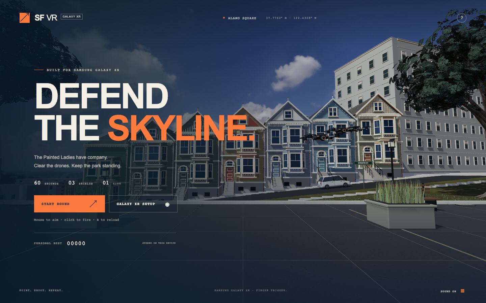
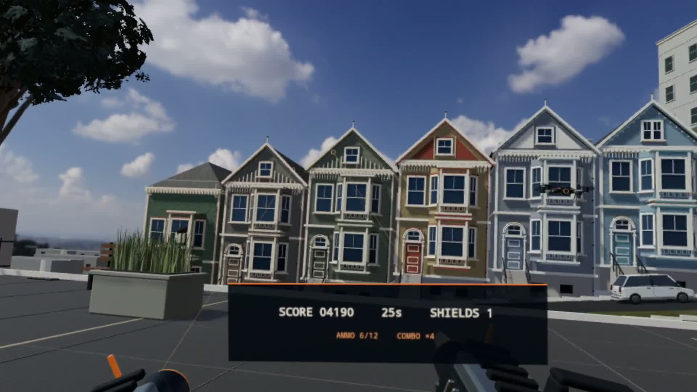

# SFVR

**Defend the skyline with your hands. Built for Samsung Galaxy XR.**

SFVR is a hand-tracked arcade shooter set in San Francisco's Alamo Square. Stand opposite the Painted Ladies, aim at incoming drones, and curl your index finger to fire. Your head controls the view; your hands control the action.

**[Play the game](https://kaushiksiva.github.io/SFVR/)** · **[Watch the 60-second demo](https://github.com/KaushikSiva/SFVR/releases/download/v0.2.0/sfvr-demo.mp4)** · [Headset setup](docs/HEADSET.md)



## One city. Sixty seconds. Three shields.

Survive a complete round before the drones breach the park. Gold targets give bonus points, armored targets take two hits, and quick eliminations build a combo up to 5×. Your twelve-shot magazine reloads automatically when empty. Scores, accuracy and personal bests encourage replay.

The environment uses full-volume buildings, detailed quadrotors and blasters, textured surfaces, an HDR sky, cached shadows, and vegetation. Lean or look around in XR to see the scene's depth. Move around the park using hand teleporting or a controller stick, with collision boundaries and no camera shake.



## Play on Samsung Galaxy XR

Open the live game in **Chrome on Galaxy XR**, choose **Enter Galaxy XR**, and allow tracking. Pinch once to start. Make a finger gun: thumb up, index extended, other fingers curled. Aim the ray, then curl your index to shoot. Extend it again for the next shot; a mint aiming ring means ready. Pinching does not shoot. To move, aim at clear ground, hold a pinch, then release on the orange ring. Red means blocked. Select **HOME** on the headset HUD to return. Controllers use their trigger to fire, with left-stick travel and right-stick 45° turns.

For local development, connect the headset by USB, enable USB debugging, and accept the headset's authorization prompt:

```sh
git clone https://github.com/KaushikSiva/SFVR.git
cd SFVR
npm ci
npm run play:xr
```

The launcher starts the server, forwards its port, opens headset Chrome, and restores forwarding after USB reconnections. Keep the terminal open. On macOS, you can also double-click **Launch SFVR.command** after installing dependencies.

For a laptop preview, run `npm run dev` and open **http://127.0.0.1:5186**. Mouse aims, click fires, **WASD / arrows** move, **H** returns home, **R** reloads, and **Escape** pauses. Touchscreens support tap-to-shoot.

## Tech stack

| Layer | Technology |
| --- | --- |
| Stereo view and hand input | WebXR in Android XR Chrome |
| Rendering and materials | Three.js, WebGL, physically based materials |
| Application | TypeScript, Vite |
| Sound and persistence | Web Audio, browser localStorage |
| Headset hardware | Samsung Galaxy XR, Qualcomm Snapdragon XR2+ Gen 2 |
| Verification | Node tests, Playwright, generic WebXR input simulation |
| Demo narration | ElevenLabs stock Brian voice; generated offline |

## Tested, with clear boundaries

The project has run on a physical Galaxy XR with scored shots using the earlier pinch controls, shown in the recorded demo. Finger-trigger controls and locomotion have automated coverage; their physical-headset check is pending. Automated checks cover a full round, touch input, reload, pause, replay and simulated stereo hand input. Run `npm test`, `npm run build`, `npm run test:browser`, `npm run test:xr`, and `npm run test:locomotion`.

Qualcomm involvement is through the headset's Snapdragon hardware and browser rendering. This version has **no QNN or ExecuTorch inference**. The city is an authored approximation; sustained performance and comfort need broader device testing.

**Team / project: SFVR.** Contributions to performance, accessibility and new drone patterns are welcome. See [contributing](CONTRIBUTING.md).

Original code is MIT licensed. Asset licenses and credits are listed in [ASSETS.md](docs/ASSETS.md).
