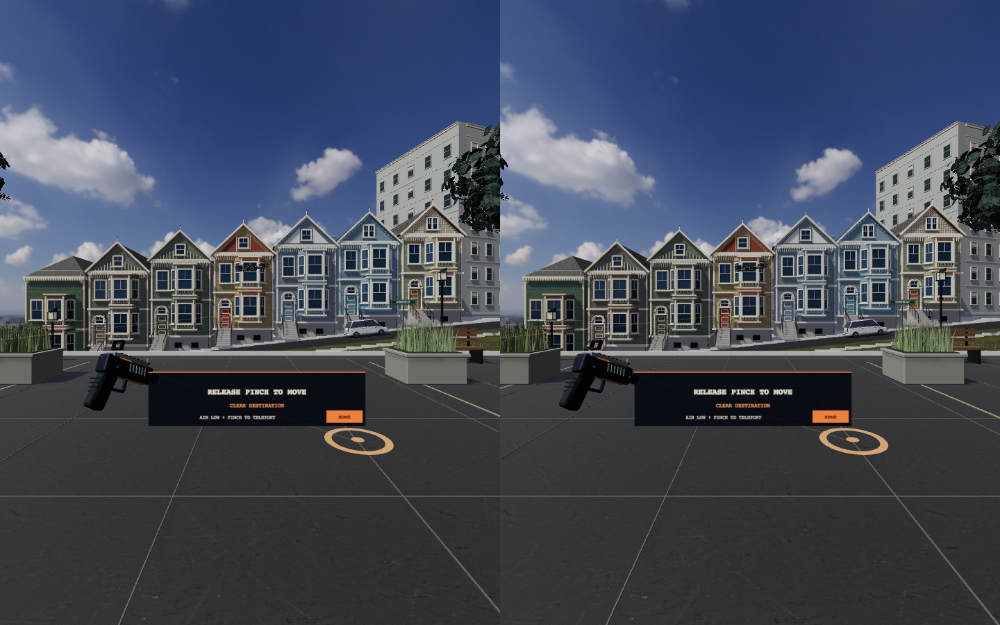

# Samsung Galaxy XR setup

## Public demo

Open **https://kaushiksiva.github.io/SFVR/** in Chrome on Samsung Galaxy XR.
Select **Enter Galaxy XR**, accept tracking permissions, then pinch once to start.
The HTTPS demo needs no USB cable or running laptop server.

## Local development

Use Node.js 22.12+ and Android SDK Platform Tools (`adb`). Connect the Galaxy XR
by USB, enable developer options and USB debugging, and approve the computer
inside the headset. Then run:

```sh
npm ci
npm run play:xr
```

The command starts the local game and opens `http://localhost:5186` on the
headset. Keep the port number: plain `localhost` addresses a different port.
On your laptop the game is at `http://127.0.0.1:5186`.

The watcher restores ADB reverse forwarding after USB reconnection. Keep the
terminal open and the laptop awake. If you prefer separate processes:

```sh
npm run dev
# Another terminal:
npm run headset
npm run headset:watch
```

`adb devices -l` must show `device`, not `unauthorized`. If unauthorized, accept
**Allow USB debugging** in the headset. If localhost is offline, reconnect the
USB cable and rerun `npm run headset`. A plain HTTP LAN URL normally cannot start
immersive WebXR; use the HTTPS demo or headset-local localhost over ADB reverse.

With several Android devices attached, set `ANDROID_SERIAL` to the Galaxy XR
serial. The automatic reconnection watcher targets Samsung model SM-I610.

## Controls

- **Fire with hands:** aim at drones and extend your index and middle fingers, with ring and little fingers curled. Hold this pose for repeated shots; fold the fingers to stop. A mint ring shows two-finger firing. **Pinch-to-fire also works:** hold a pinch for a burst, release to stop. The earlier single-index curl gesture still fires one shot.
- **Start / replay / resume:** pinch once. That selection does not also fire a shot.
- **Teleport:** during play, point either hand at clear ground. Hold a pinch to choose a destination and release to move. An orange ring means clear; red means blocked. Aim away before releasing to cancel.
- **Home:** point at **HOME** on the headset HUD and pinch to return to the starting position.
- **Controllers:** trigger fires or teleports when aimed at ground; the left stick moves relative to your viewing direction, and the right stick turns 45° per deflection. Return the stick to center before turning again.
- **Laptop:** mouse and click, WASD or arrows to move, H return home, R reload, Escape pause.
- **Phone:** tap drones; tap the ammo counter to reload.

Virtual travel stays within the flat park area and avoids planters, benches and the litter bin. Teleporting has a 10-meter range and a brief fade; hand tracking loss or pausing cancels an armed teleport. Head height and physical tracking are preserved. Physical movement itself is not constrained by the game's navigation boundaries.

The pale aiming ring confirms that a ray intersects a drone. Empty magazines
reload automatically. Use the headset's system controls to exit immersive mode;
the game pauses on exit or when the XR session loses visibility.



## Validation

The real SM-I610 has loaded the game, entered immersive mode, exposed both
tracked hands, and registered successful shots with the earlier pinch controls. The generic IWER test rig is
only for WebXR API/input regression checks, not Samsung hardware emulation.

Official platform documentation: [Android XR for WebXR](https://developer.android.com/develop/xr/web).

Locomotion has automated coverage for hand teleporting, room-scale offsets, blocked destinations, cancellation, Home, stick movement, snap turns and keyboard controls. Hand firing has unit and WebXR integration coverage for both hands, two-finger bursts, pinch bursts, release-to-stop, tracking recovery, navigation and pause. Physical Galaxy XR validation of the new two-finger gesture and movement/comfort is still pending.
