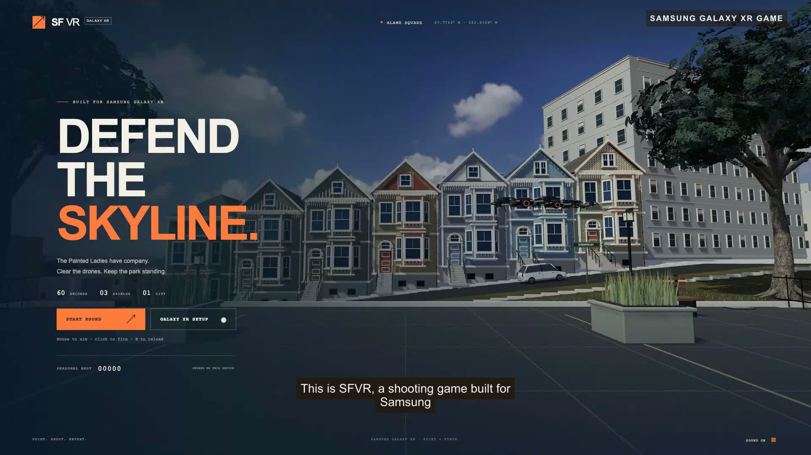

# SFVR demo

[Download the one-minute video](https://github.com/KaushikSiva/SFVR/releases/download/v0.2.0/sfvr-demo.mp4) · [Captions](sfvr-demo.srt) · [Narration script](narration.txt)



The finished video is exactly 60 seconds, 1920 × 1080, H.264 / AAC. It combines actual desktop gameplay with **18 seconds recorded on a physical Samsung Galaxy XR**, showing tracked hands, head movement and scored hits. Each segment is labeled on screen. The desktop round uses automated pointer inputs; the headset segment uses the player's real hand input. The game logic and rendering are unmodified.

The narrator is ElevenLabs' stock **Brian** voice using `eleven_multilingual_v2`. Timing data is used for synchronized captions. Samsung Galaxy XR is identified in the opening, persistent label, narration and end card. No custom cloned voice is used.

To reproduce locally, install Node.js 22+, Python 3, ffmpeg, and Chrome. Start the development server with `npm run dev`, then:

```sh
node scripts/capture-demo.mjs
python3 scripts/render-demo.py
```

To regenerate the voice, set `ELEVENLABS_API_KEY` in the ignored `.env` file and run `python3 scripts/narrate-demo.py` before rendering. Voice generation uses the ElevenLabs API and may incur charges on your account. The 18-second headset clip and existing narration are included; generating it again is optional.
